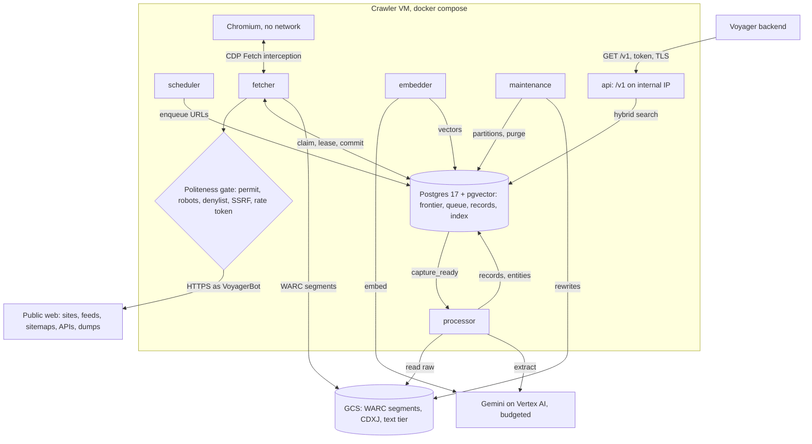

# Voyager Crawler

A polite, raw-first, versioned travel-data crawler, index and read API for
[Voyager](https://github.com/rupakc/travel-planner), the open-source AI travel planner.

Voyager's planning agents need current, attributed facts: visa rules, travel advisories,
events, attractions, weather normals, exchange rates, transport options. Today they mostly
rely on the model's own knowledge. This crawler collects those facts from vetted public
sources, keeps every raw response, turns them into clean, versioned records with full
provenance and licence, and serves them to Voyager through a private API.

It is one Rust binary (`vcrawl`) with several roles, Postgres 17 + pgvector, Google Cloud
Storage for raw WARC files, and Gemini on Vertex AI under a hard budget. It is designed to
run on one small GCP VM for about $100 a month.

**Documentation: the [wiki](https://github.com/rupakc/travel-planner-crawler/wiki)**, generated from [`docs/wiki/`](docs/wiki/).

## An honest crawler

The bot is called **VoyagerBot**. Its identity, behaviour and opt-out are in
**[BOT.md](BOT.md)**.

- **One identity.** Every request, plain HTTP or headless browser, sends
  `VoyagerBot/<version> (+https://github.com/rupakc/travel-planner-crawler/blob/main/BOT.md)`
  from one static IP, published in BOT.md before the first crawl. No User-Agent, header or
  fingerprint rotation, no proxies.
- **No bot-detection evasion, ever.** A challenge page, 401 or 403 means "stop": the site is
  parked for at least 24 hours. No stealth plugins, no CAPTCHA solving, no retry with another
  identity. CI bans the known evasion crates.
- **robots.txt first** (RFC 9309, stricter where it matters), plus Crawl-delay,
  `X-Robots-Tag`, meta robots, TDM reservations and `Content-Signal`. Sites that opt out of
  AI keep only a title and a link.
- **Slow by design.** One request at a time per site, at least 5 seconds apart, a daily
  budget per site, and a global rate limit.
- **Never fetched:** the sites on the public [denylist](policy/denylist.yaml).
- **No republishing.** Blogs and news are served only as facts, a headline, an excerpt of at
  most 300 characters and a link back.
- **Removable.** Opt-outs leave the API within 24 hours and every copy within 21 days.

More: [Politeness and Robots](https://github.com/rupakc/travel-planner-crawler/wiki/Politeness-and-Robots).

## Architecture



How it fits together: [Architecture](https://github.com/rupakc/travel-planner-crawler/wiki/Architecture) and
[How a Page Gets Crawled](https://github.com/rupakc/travel-planner-crawler/wiki/How-a-Page-Gets-Crawled).

## Status

| Part | State |
|---|---|
| Design (spec v3) and implementation plan | Done |
| Library crates `vc-*`, migrations, testkit with fakes and oracles | Done, tested in CI |
| Deploy kit and GCP bootstrap | Done, tested with fakes |
| `vcrawl` binary (wiring the roles) | In progress: `processor`, `embedder` and `api` are wired; `scheduler`, `fetcher`, `maintenance`, `admin` and `migrate` are not yet |
| End-to-end test in CI | Not started |
| Agentic loops (link triage, source scout, quality auditor) | Not started |
| Provisioning and go-live | Not started; the LLM stays off until the owner raises the project cap |
| Voyager backend integration | Not started (main repo, behind a flag) |

## Quick start (development)

You need Rust (the toolchain in `rust-toolchain.toml` installs itself through rustup),
Docker (tests start Postgres with testcontainers) and Python 3 for the scripts.

```bash
git clone https://github.com/rupakc/travel-planner-crawler.git
cd travel-planner-crawler
cargo build --workspace
cargo test --workspace                 # needs Docker
cargo clippy --workspace --all-targets -- -D warnings
cargo deny check
python3 -m pytest -q scripts/tests
```

Configuration has a default for every setting; override with `VC_<SECTION>_<FIELD>`
environment variables or a TOML file named by `VC_CONFIG`. See
[Configuration](https://github.com/rupakc/travel-planner-crawler/wiki/Configuration).

## Repository layout

```
crates/          the Rust workspace
  vc-core          shared ids and types, and every trait between crates (frozen)
  vc-config        settings: defaults, TOML, VC_* env
  vc-policy        robots.txt, denylist, SSRF guard, challenge detection (pure)
  vc-frontier      Postgres frontier: claims, fenced leases, rate tokens, parking
  vc-fetch         the only HTTP client for crawl targets (permit-gated)
  vc-render        headless Chromium through CDP Fetch interception
  vc-store         WARC/CDXJ, fsynced spool, segments, GCS, purge
  vc-parse         content handlers: HTML, RSS/Atom, sitemaps, JSON, CSV
  vc-kinds         record kinds from schemas/, prompts/ and kinds.toml
  vc-llm           Gemini on Vertex, embeddings, budget ledger, batch jobs
  vc-extract       structured-first extraction, grounding checks, places
  vc-sources       source files, seeding, API and dump adapters
  vc-queue         Postgres work queue
  vc-index         records, versions, entities, hybrid search, change feed
  vc-api           the private /v1 read API
  vc-obs           logs, metrics, health, heartbeat
  vc-secrets       Secret Manager and env secrets
  vcrawl           the binary: roles, admin CLI, migrate
testkit/         Postgres per test, fakes, fake web/Gemini/GCS, oracles
migrations/      SQL migrations (expand-only)
sources/         one YAML per source (117)      schemas/  JSON Schemas
kinds.toml       kind policy                     prompts/  extraction prompts
policy/          denylist, sub-resource allowlist
deploy/          the VM's compose kit, deployer, watchdog, systemd units
infrastructure/  idempotent gcloud bootstrap, bucket lifecycle, alert policies
scripts/         source generator, ownership check
docs/            design spec, plan, reviews, research, wiki sources
```

## Documentation

| Topic | Wiki page |
|---|---|
| Overview | [Home](https://github.com/rupakc/travel-planner-crawler/wiki), [Architecture](https://github.com/rupakc/travel-planner-crawler/wiki/Architecture), [Glossary](https://github.com/rupakc/travel-planner-crawler/wiki/Glossary), [FAQ](https://github.com/rupakc/travel-planner-crawler/wiki/FAQ) |
| How it works | [How a Page Gets Crawled](https://github.com/rupakc/travel-planner-crawler/wiki/How-a-Page-Gets-Crawled), [Storage and Raw Data](https://github.com/rupakc/travel-planner-crawler/wiki/Storage-and-Raw-Data), [Rendering with Chromium](https://github.com/rupakc/travel-planner-crawler/wiki/Rendering-with-Chromium), [Processing and Extraction](https://github.com/rupakc/travel-planner-crawler/wiki/Processing-and-Extraction) |
| Data | [Data Model](https://github.com/rupakc/travel-planner-crawler/wiki/Data-Model), [Sources and Licences](https://github.com/rupakc/travel-planner-crawler/wiki/Sources-and-Licences), [Read API](https://github.com/rupakc/travel-planner-crawler/wiki/Read-API) |
| Cost and AI | [Gemini and Budgets](https://github.com/rupakc/travel-planner-crawler/wiki/Gemini-and-Budgets), [Agentic Loops](https://github.com/rupakc/travel-planner-crawler/wiki/Agentic-Loops) |
| Running it | [Operations and Deploy](https://github.com/rupakc/travel-planner-crawler/wiki/Operations-and-Deploy), [Configuration](https://github.com/rupakc/travel-planner-crawler/wiki/Configuration), [Security](https://github.com/rupakc/travel-planner-crawler/wiki/Security) |
| Developing | [Contributing](https://github.com/rupakc/travel-planner-crawler/wiki/Contributing), [Testing](https://github.com/rupakc/travel-planner-crawler/wiki/Testing), one page per crate |

The design spec ([`docs/superpowers/specs/`](docs/superpowers/specs/2026-11-15-voyager-crawler-design.md),
§17 normative) and the decision ledger ([MEMORY.md](MEMORY.md)) are the source of truth.

Contributing: [CONTRIBUTING.md](CONTRIBUTING.md). Security reports: [SECURITY.md](SECURITY.md).

## Licence

Code: MIT ([LICENSE](LICENSE)). Collected data keeps its source licence; every API item
carries `licence {class, spdx, attribution, url}`. Place data contains data from GeoNames
(geonames.org), CC BY 4.0.
