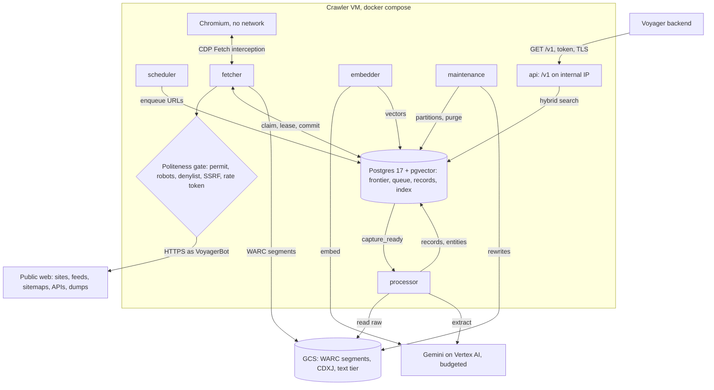
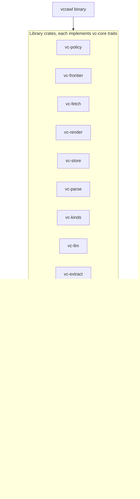

# Architecture

The crawler is **one Rust binary, `vcrawl`, run as several processes** ("roles") on one VM.
The roles never talk to each other directly. They share state through **Postgres** (the
to-do list of URLs, the work queue, the records) and **GCS** (the raw pages).

## Diagram

The **politeness gate** is not a separate service. It is a set of checks that every request
to a crawl target must pass, built into `vc-frontier` (who may request) and `vc-fetch` (how
the request is made). Chromium's requests go through the same gate because Chromium has no
network: the fetcher answers each of its requests itself. See
[Politeness and Robots](Politeness-and-Robots) and [Rendering with Chromium](Rendering-with-Chromium).

## Roles

| Role | Job | Memory limit | Main crates |
|---|---|---|---|
| `scheduler` | Turns sources into URLs: seeds, sitemaps, feeds. Schedules recrawls and robots.txt refreshes. | 256 MB | vc-sources, vc-frontier |
| `fetcher` | The claim loop: claim a site, fetch its leased URLs politely, render when needed, write raw records, commit segments. Runs API adapters. | 512 MB | vc-frontier, vc-fetch, vc-render, vc-store |
| `processor` | Turns committed captures into records: parse, structured data, LLM extraction, grounding checks, place resolution, index. | 768 MB | vc-parse, vc-extract, vc-kinds, vc-llm, vc-index |
| `embedder` | Adds vector embeddings for current records. | 256 MB | vc-llm, vc-index |
| `api` | The private `/v1` read API for Voyager. | 512 MB | vc-api, vc-index |
| `maintenance` | Partitions, purges, ephemeral expiry, dumps in their nightly window, restore drills, daily digest. | 256 MB | vc-store, vc-index, vc-sources |
| `admin` | Command-line tools: status, source validate/approve, purge, rebuild-captures, re-extract. | n/a | all |
| `migrate` | Applies database migrations before a deploy rolls the roles. | 256 MB | sqlx migrations |

Postgres gets 3 GB and Chromium 1.5 GB. The total is about 7 GB of the VM's 8 GB.

> **Status:** every library the roles need is built and tested. In `crates/vcrawl`, the
> `processor`, `embedder` and `api` roles are wired; `scheduler`, `fetcher`, `maintenance`,
> `admin` and `migrate` still print "… is not wired yet".
> See [vcrawl](Crate-vcrawl).

## Crates: a star graph

All shared types and **every trait between crates** live in `vc-core`. Each library crate
depends only on `vc-core`, `vc-config` and (for tests) `testkit`. Only the `vcrawl` binary
depends on the implementations and plugs them together. This lets each crate be built and
tested alone, with fakes.

| Trait (in vc-core) | What it hides | Implemented by |
|---|---|---|
| `Policy` | robots, denylist, SSRF, challenge detection | [vc-policy](Crate-vc-policy) |
| `Frontier`, `LeaseCheck` | claims, leases, rate tokens, enqueue, park | [vc-frontier](Crate-vc-frontier) |
| `PermitClient` | permit-gated HTTP | [vc-fetch](Crate-vc-fetch) |
| `Renderer` | Chromium through CDP interception | [vc-render](Crate-vc-render) |
| `BlobStore`, `CaptureSink`, `SegmentCommitter` | GCS or disk, spool, commit | [vc-store](Crate-vc-store) |
| `ContentHandler` | one parser per media type | [vc-parse](Crate-vc-parse) |
| `KindRegistry` | entity kinds from data files | [vc-kinds](Crate-vc-kinds) |
| `LlmClient`, `Embedder`, `BudgetLedger`, `BatchRunner` | Gemini, embeddings, spend control | [vc-llm](Crate-vc-llm) |
| `PlaceResolver` | place names to GeoNames ids | [vc-extract](Crate-vc-extract) |
| `SourceAdapter` | API and dump sources | [vc-sources](Crate-vc-sources) |
| `WorkQueue` | jobs between roles | [vc-queue](Crate-vc-queue) |
| `RecordSink`, `IndexReader` | write and read the index | [vc-index](Crate-vc-index) |
| `SecretSource` | Secret Manager or env | [vc-secrets](Crate-vc-secrets) |

## Data flow in one paragraph

Source files in `sources/` become URLs in the **frontier** (Postgres tables `urls` and
`url_state`, grouped by **politeness key**, usually one per site). A fetcher **claims** one
key at a time and gets a **permit** plus up to 5 due URLs. It fetches them one by one, with
a delay, after checking robots.txt, the denylist and the address. Each response is written as
a WARC record to a local **spool** file and fsynced. A **segment roller** packs spool files
into compressed WARC segments, uploads them to GCS, and only then commits the capture rows
in one transaction. That commit also queues `capture_ready` work. The processor parses the
capture, extracts records (structured data first, Gemini second, under a budget), checks
them against the page text, resolves places, and writes versioned records and entities. The
API serves them, with licence rules applied, to Voyager.

## Why this design

| Choice | Why |
|---|---|
| Own Rust core, not the `spider` crate | `spider` has bot-evasion features on by default. That conflicts with the core promise. |
| One VM, not managed services | Cloud Run + Pub/Sub + Cloud SQL would cost $150–250+ a month. Traits keep that path open. |
| Postgres as frontier and queue | One place for claims, leases and rate tokens, so politeness holds across processes. `FOR UPDATE SKIP LOCKED` gives fair, lock-free claiming. |
| WARC segments in GCS, not one object per page | One object per page would cost about $125 a month in GCS operations. |
| Self-hosted Postgres 17 + pgvector | Cloud SQL is too small or too expensive at this size. Backups go to GCS with wal-g. |
| Gemini only, off by default | The crawler shares a GCP project with Voyager. Its spend must never switch off Voyager's AI. |
| gcloud bootstrap script, no Terraform | Same pattern as the main repo; idempotent, with a dry run and tests. |

## Scaling later

| Area | Today | At 10x |
|---|---|---|
| Fetchers | one VM | more VMs, each leasing a set of `shard`s, each with its own published IP |
| Frontier | Postgres | already partitioned; a bigger Postgres or another store behind the `Frontier` trait |
| Work queue | Postgres | Pub/Sub behind the `WorkQueue` trait |
| Embeddings | in the main database | a dedicated pgvector instance or Vertex Vector Search |
| Old versions and captures | Postgres | exported to Parquet after 12 months |
| Raw storage | Standard, then Coldline | Standard, Coldline, then Archive |

See also: [How a Page Gets Crawled](How-a-Page-Gets-Crawled), [Data Model](Data-Model),
[Operations and Deploy](Operations-and-Deploy).
