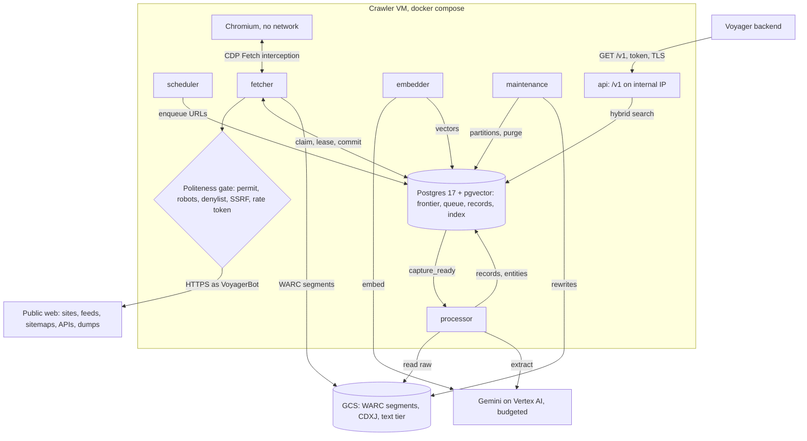

# Voyager Crawler

The Voyager Crawler collects public travel information, stores it safely, cleans it up, and
serves it to [Voyager](https://github.com/rupakc/travel-planner), the open-source AI travel
planner. Voyager's planning agents can then cite current, attributed facts instead of
guessing.

It is one Rust program (`vcrawl`) with several roles, one Postgres database, a Google Cloud
Storage (GCS) bucket for raw pages, and Gemini on Vertex AI for the few jobs that need a
language model. It runs on one small Google Cloud VM for about $100 a month. Code licence:
MIT.

## The three promises

1. **Honest crawling.** The bot is called `VoyagerBot`. It always says who it is, obeys
   robots.txt and every opt-out signal, waits between requests, and never tries to get past
   bot protection. A block means "stop", never "try another way". See
   [Politeness and Robots](Politeness-and-Robots).
2. **Raw first.** Every response is saved to durable storage before anything built from it
   becomes visible. Raw data is never changed, so any result can be traced back and rebuilt.
   See [Storage and Raw Data](Storage-and-Raw-Data).
3. **Licence aware.** Every item carries its source, licence and attribution. Articles from
   blogs and news are served only as facts, a headline, a short excerpt and a link. See
   [Sources and Licences](Sources-and-Licences).

## Architecture at a glance

More detail: [Architecture](Architecture) and [How a Page Gets Crawled](How-a-Page-Gets-Crawled).

## Status (November 2026)

| Part | State |
|---|---|
| Design (spec v3) and plan | Done |
| Library crates (`vc-*`), migrations, testkit with fakes and oracles | Done, tested in CI |
| Deploy kit (`deploy/`) and GCP bootstrap (`infrastructure/`) | Done, tested with fakes |
| `vcrawl` binary: wiring the roles together | **In progress.** `processor`, `embedder` and `api` are wired; `scheduler`, `fetcher`, `maintenance`, `admin`, `migrate` and `health` still exit with "not wired yet" |
| End-to-end test in CI (fake internet, two fetchers) | Not started |
| Agentic loops (link triage, source scout, quality auditor) | Not started |
| Provisioning and go-live on GCP | Not started |
| Voyager backend reading the API | Not started (main repo, behind a flag) |

Pages describe what the code does today. Where a part is designed but not yet built, the
page says so in a **Status** note.

## Where to start

| If you want to… | Read |
|---|---|
| Understand the system | [Architecture](Architecture), [How a Page Gets Crawled](How-a-Page-Gets-Crawled) |
| Know how the bot behaves on your site | [Politeness and Robots](Politeness-and-Robots), [FAQ](FAQ) |
| Use the data | [Read API](Read-API), [Data Model](Data-Model) |
| Change the code | [Contributing](Contributing), [Testing](Testing), the crate pages in the sidebar |
| Run it | [Operations and Deploy](Operations-and-Deploy), [Configuration](Configuration) |
| Look up a word | [Glossary](Glossary) |

## Source of truth

These pages summarise the repository. When they disagree, the repository wins:
the design spec `docs/superpowers/specs/2026-11-15-voyager-crawler-design.md` (its §17 overrides
earlier sections), the plan `docs/superpowers/plans/2026-11-15-voyager-crawler.md`, the
decision ledger `MEMORY.md`, and the rustdoc of each crate.
