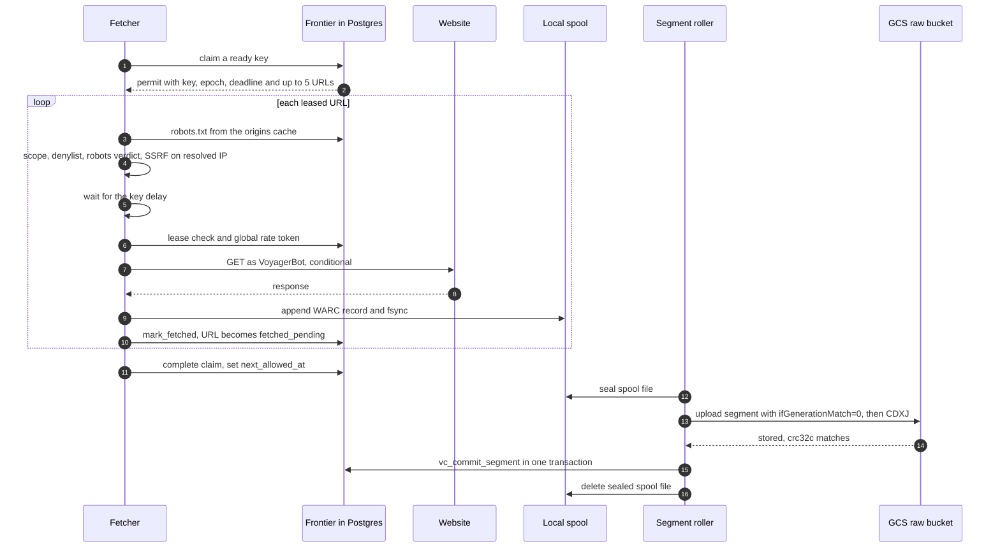
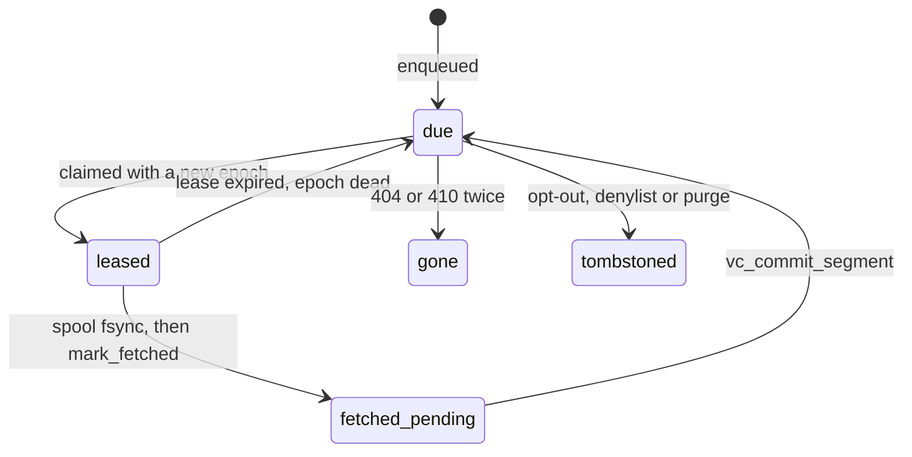

# How a Page Gets Crawled

This page follows one URL from a source file to the read API. Words in **bold** are
explained in the [Glossary](Glossary).

> **Status:** every step below runs in production code. The `vcrawl` roles run them in
> order, and the end-to-end test in CI checks the whole path on a fake internet (see
> [Testing](Testing)).

## 1. A source becomes URLs

- Each site or API is described by one YAML file in `sources/` (see
  [Sources and Licences](Sources-and-Licences)).
- The `scheduler` loads these files (`vc-sources`), writes them to the `sources` table, and
  **enqueues** their seed, sitemap and feed URLs into the **frontier**.
- Every URL is first **canonicalised** (lowercase host, no fragment, no tracking parameters,
  sorted query; see [vc-core](Crate-vc-core)). Its identity is a 128-bit blake3 hash of the
  canonical URL, the `UrlKey`.
- Each URL belongs to a **politeness key** (by default the registrable domain, such as
  `example.com`). All politeness rules (delay, one request at a time, daily budget, parking)
  apply per key.
- Enqueueing is batched (1,000 rows) and ignores URLs that already exist, so a known URL
  keeps its own schedule.
- API and dump sources get one `adapter:<id>` row instead of page URLs.
- A source's `min_delay_s` can only raise its key's delay, and `daily_budget` can only
  lower its budget. Rows of a disabled source are retired (`disabled`).

## 2. A fetcher claims a key

The fetcher asks the frontier for work with `Frontier::claim`. In one transaction, Postgres:

1. picks one ready key with `FOR UPDATE SKIP LOCKED`: not parked, under its daily budget,
   `next_allowed_at ≤ now()`, and no live claim;
2. gives it a new **epoch** (a number from a sequence that only goes up);
3. sets a **deadline**: number of URLs × the per-URL budget (240 s by default);
4. leases up to **5 due URLs** of that key, highest priority first;
5. moves the key's `next_allowed_at` to `deadline + delay`, so a crashed holder still blocks
   the key until its deadline has passed and the delay has been waited.

The fetcher receives a **`ClaimPermit`**. Only `vc-frontier` can create one. Without it, no
code can make a request to a crawl target.

**robots.txt first.** Every origin of the claim whose robots.txt is missing or expired is
fetched first, under the same permit, and stored raw like any page. A `Crawl-delay` learned
there raises the permit's delay at once (`raise_delay`, capped at `frontier.max_delay_s`, 1 h by default), so every
later URL, redirect hop and sub-request of the same claim waits that long. 401, 403 or a
challenge on robots.txt makes the whole key do-not-crawl and parks it; 429 or 503 backs the
key off. Paths that robots.txt newly disallows are tombstoned.

## 3. The fetch, request by request

For each leased URL, and again for each redirect hop, `vc-fetch` checks, in this order:

| Step | Check | On failure |
|---|---|---|
| 1 | The URL is in the permit's scope (its key, or an allowlisted sub-resource host for renders). Denylisted hosts and private IP literals are refused first. | Out of scope. A redirect to another key is **enqueued**, never followed. |
| 2 | robots.txt for that origin, from the frontier's cache. | Missing or stale robots fails closed (no request). |
| 3 | DNS is resolved once; every address goes through the SSRF guard; the first good address is pinned for the connection. | Blocked. |
| 4 | Wait until the last request's end + the key's delay. | — |
| 5 | Lease check + one token from the **global rate bucket** (4 requests/s across all processes), in one statement. | Lease lost: stop. |
| 6 | Send the request with the one `VoyagerBot` User-Agent, no cookies, timeouts capped by the deadline, conditional headers (`If-None-Match`, `If-Modified-Since`) when known. | — |

Then the response is classified:

- **401, 403 or a challenge page:** stop. The key is **parked** for 24 hours (doubling up to
  30 days). Never retried with a browser or another identity.
- **429 or 503:** the claim stops. The key's penalty becomes the largest of `Retry-After`,
  twice the previous penalty and twice the delay, capped at 24 hours. A short
  `Retry-After` never cancels the doubling. API adapters, dumps and robots.txt follow the
  same rule.
- **5 server errors in a row:** park for 1 hour. Any success ends the run of errors.
- **404 or 410:** counted toward `gone`.
- **304 Not Modified:** a `revisit` of the last committed capture, so it always points at a
  body we have.
- **Body:** decoded (gzip, deflate) under a byte cap (HTML 5 MB, other 10 MB) and checked
  against the content-type allowlist.

A redirect to the same key but to an origin with no cached robots.txt (apex to `www`, http
to https) fetches that robots.txt under the same permit and retries the URL once.

JavaScript-only pages are rendered in Chromium instead, with every sub-request going through
the same checks. A rendered page's own status follows the same ladder as above. A
sub-request to another site on the sub-resource allowlist (a CDN) must **borrow** that
site's key, so its delay holds too. See [Rendering with Chromium](Rendering-with-Chromium).

## 4. Raw first: spool, segment, commit



1. **Spool.** The response becomes a WARC record. It is appended to the fetcher's local
   spool file and **fsynced** before the call returns.
2. **Mark fetched.** A small, epoch-checked update moves the URL from `leased` to
   `fetched_pending` and sets `next_fetch_at`. Validators (ETag, Last-Modified, payload hash)
   are **not** touched yet.
3. **Segment.** At 128 MiB or 10 minutes, the spool file is sealed and packed into a
   compressed WARC **segment**. It is uploaded to
   `gs://voyager-crawler-raw/segments/YYYY/MM/DD/<segment-ULID>.warc.zst` with
   `ifGenerationMatch=0`: an identical existing object counts as success, a different one is
   an error. The **CDXJ** index goes next to it.
4. **Commit.** One call to the SQL function `vc_commit_segment` inserts the `segments` row,
   the `captures` rows, updates the URL's validators (only if this capture is newer than the
   last one), returns the URL to `due`, and queues `capture_ready` work.
5. **Clean up.** Only after the commit is the sealed spool file deleted. On start, every
   sealed file is replayed; steps 3 and 4 are idempotent by segment id. A replayed file
   whose segment is already committed is deleted without uploading again.

Safety nets around this path:

| Problem | What happens |
|---|---|
| A fetcher dies and a new one starts with another instance name | Each fetcher locks its own spool directory. Every roller tick it **adopts** sibling spool directories whose lock is free, publishes them and removes them. Unpublished orphan bytes count toward backpressure. |
| A URL stays `fetched_pending` (lost spool, race with the commit) | `mark_fetched` waits for a concurrent commit and goes straight to `due` if its capture is already committed. A sweeper, every 10 min, returns rows pending longer than 6 h to `due`. |
| A sealed spool file is damaged | It is skipped so newer files still publish, and renamed `*.quarantined` after 3 tries. |
| A seal fails after the record was fsynced | The append still succeeds; the seal is retried. |

Until step 4, nothing built from the capture is visible, and the frontier still holds the
**old** validators. So a crash can never cause a `304` for a body that was never stored.

## 5. URL states



- `leased` URLs whose epoch is dead go back to `due` the next time that key is claimed.
- `fetched_pending` URLs are never leased again; the spool replay, spool adoption or the
  6-hour sweeper finishes them.
- The table also allows `disabled` (source turned off).
- A url, prefix, host or source purge moves matching rows to `tombstoned`, even while
  leased, so purged URLs leave the crawl.

## 6. Completing the claim

`Frontier::complete` is fenced by the epoch: if a newer claim exists, the old holder's
update is rejected. It applies each URL's result, updates the key's latency average, and
sets the next allowed time:

```
delay = max(robots Crawl-delay, source min_delay_s (≥ 5 s), 10 × EWMA latency, penalty), capped at 1 h
next_allowed_at = max(deadline, last request end + delay)
```

## 7. Processing

`capture_ready` work is taken by the `processor` (at-least-once; every write is idempotent):

1. the content handler for the media type parses it (HTML, RSS/Atom, sitemap, JSON, CSV);
2. new links are enqueued; sitemaps and feeds fan out; uncertain in-scope links go to
   [link triage](Agentic-Loops) when the LLM is on;
3. structured data (JSON-LD, microdata) becomes records with no LLM;
4. if allowed and budgeted, Gemini extracts records from the main text;
5. grounding checks drop anything not found in the page;
6. places are resolved to GeoNames ids;
7. records, versions, entities and observations are written, with a change-feed row;
8. records a newer capture no longer contains are marked **stale** (still served, never
   deleted), and come back if a later capture has them again;
9. high-stakes records waiting for a second source are kept in `held_records` (shared by
   every processor, bounded, 7-day expiry).

Separately, the processor writes the **extracted-text tier**: one compressed JSON-lines
object per committed segment with each page's main text, used by the quality auditor and
for re-extraction. A 304 chain (`revisit` of a `revisit`) is followed back to the stored
body.

Details: [Processing and Extraction](Processing-and-Extraction).

## 8. Recrawl

The next visit is estimated from how often the page changed before (the Cho and
Garcia-Molina estimator), bounded by the source's cadence (hourly to yearly). Conditional
GET keeps unchanged pages cheap. A payload identical to the last one is stored as a short
WARC `revisit` record.

See also: [Politeness and Robots](Politeness-and-Robots), [Storage and Raw Data](Storage-and-Raw-Data).
