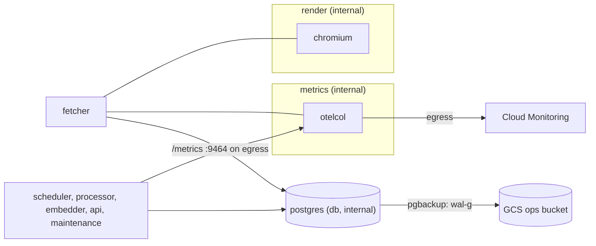
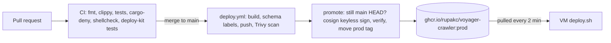

# Operations and Deploy

The crawler runs on **one Google Cloud VM** in project `voyager-prod-ohzkl` (us-east1), next
to the Voyager app VM. Everything runs in Docker Compose. GitHub Actions builds and signs
images but has **no cloud credentials**: the VM pulls and verifies images itself.

> **Status:** the deploy kit (`deploy/`), the bootstrap script (`infrastructure/`), the
> image build and promotion are done and tested (with fakes for GCP). Every `vcrawl` role
> is wired, and the E2E stack runs in CI (see [Testing](Testing)). Nothing is provisioned
> yet: go-live (Task 18) is the next step. The monthly Spot restore drill is not wired.

## The GCP footprint

`infrastructure/bootstrap.sh` creates all of this. It is idempotent and has `--dry-run`.
A second run creates nothing, and **re-asserts** settings that may have drifted: IAM
bindings, custom-role permissions, bucket settings and labels, firewall rules (all but
direction and action), the log bucket's retention and sink filter, the alert channel's
email (`CRAWLER_ALERT_EMAIL`), every alert policy (updated from its file) and the budget.
Every resource is labelled `app=voyager-crawler`.

| Kind | Name | Notes |
|---|---|---|
| VM | `voyager-crawler` | e2-standard-2 (2 vCPU, 8 GB), Debian 12, Shielded VM, OS Login, auto-restart, deletion protection |
| Data disk | `crawler-data` | 100 GB pd-balanced at `/var/lib/voyager-crawler` (Postgres data, spool, deploy state); daily snapshots kept 7 days |
| IPs | `crawler-internal-ip`, `crawler-external-ip` | static internal (the API, in the TLS cert); static external (the crawl identity in BOT.md) |
| Buckets | `voyager-crawler-raw`, `voyager-crawler-ops` | raw segments and text; backups and batch I/O |
| Service accounts | `crawler-runtime`, `crawler-drill` | the VM; the monthly restore-drill VM (not wired yet) |
| Custom roles | `voyagerCrawlerVertex`, `voyagerCrawlerDrill` | Vertex predict and batch jobs; create/delete only `crawler-drill-*` instances. The drill role is **not bound yet** |
| Instance template | `crawler-drill-template` | Spot e2-standard-2 for the future monthly drill, max 4 h, deleted on stop |
| Secrets | `crawler-pg-password`, `crawler-api-token-voyager`, `crawler-api-tls-key`, `crawler-api-tls-cert` | the TLS pair is a self-signed P-256 cert for the internal IP, 2 years |
| Firewall | `allow-crawler-api`, `allow-crawler-iap-ssh`, `deny-crawler-ingress` | 8443 only from the app VM's account; SSH only through IAP; everything else denied |
| Monitoring | channel "Voyager crawler alerts" + 12 alert policies | its own email channel, so the app's channel stays quiet |
| Logs | bucket and sink `voyager-crawler-logs` | us-east1, 30-day retention, INFO and up; excluded from `_Default`, so logs are stored once |
| Budget | `voyager-crawler` | ₹9,000/month on the label, alerts at 50, 90 and 100 % |

```bash
CRAWLER_ALERT_EMAIL=… infrastructure/bootstrap.sh --dry-run   # print every command
CRAWLER_ALERT_EMAIL=… infrastructure/bootstrap.sh             # provision
infrastructure/bootstrap.sh --rotate-tls                                    # new API key and cert
infrastructure/bootstrap.sh --update-host                                   # push a changed deploy/ to the VM
```

## Containers on the VM

| Service | Image | Networks | Memory |
|---|---|---|---|
| `postgres` | `pgvector/pgvector:pg17`, pinned by digest; wal-g mounted read-only | `db`, `pgbackup` | 3 GB |
| `chromium` | `chromedp/headless-shell`, pinned by digest; started by `deploy/chromium/run.sh` | `render` only | 1.5 GB |
| `otelcol` | `otel/opentelemetry-collector-contrib`, pinned by digest | `egress`, `metrics` | 128 MB |
| `scheduler`, `maintenance`, `embedder` | the `vcrawl` image | `db`, `egress` | 256 MB each |
| `fetcher` | the `vcrawl` image, spool on the data disk, stable instance name `fetcher-a` | `db`, `egress`, `render`, `metrics` | 512 MB |
| `processor` | the `vcrawl` image | `db`, `egress` | 768 MB |
| `api` | the `vcrawl` image, published on the internal IP:8443 | `db`, `egress` | 512 MB |
| `migrate` | one-shot, run by `deploy.sh` | `db`, `egress` | 256 MB |

| Network | Purpose |
|---|---|
| `db` | internal (no route out): Postgres and the roles |
| `render` | internal: Chromium and the fetcher only |
| `egress` | roles that call GCS, Vertex, the metadata server, or (fetcher only, with permits) the web |
| `pgbackup` | Postgres alone: wal-g's route to the ops bucket |
| `metrics` | internal, `192.168.250.0/29`: only the fetcher and `otelcol`. The fetcher's `/metrics` and `/healthz` listen here (`192.168.250.2:9464`), so Chromium on `render` cannot reach them |



The fetcher's spool lives under `spool/fetcher-<instance>/`. The fixed instance name
(`VC_VCRAWL_INSTANCE=fetcher-a`) keeps that path when the container is recreated.

Every role container: read-only root, user 65532, all capabilities dropped,
`no-new-privileges`, `restart: unless-stopped`, logs rotated. Secrets arrive as files in
`/run/secrets`, never as environment values, and are written to tmpfs only.

## Build and release



- On `main`, after CI passes: build `ghcr.io/rupakc/voyager-crawler`, scan with Trivy, sign
  with **cosign keyless** (GitHub OIDC to Sigstore), verify, then move the `prod` tag.
- Signing happens only in the promote job, and only if the commit is still main's HEAD. So
  every signed image passed CI.
- Image labels `io.voyager-crawler.schema` and `io.voyager-crawler.min-schema` come from
  the binary itself: the workflow builds the image, runs `vcrawl migrate --print-schema`
  in it with no network, then pushes with the labels. See [Data Model](Data-Model).
- Promotion **carbon-copies** the signed manifest to `:prod`
  (`imagetools create --prefer-index=false`). Without this, `:prod` pointed at a new,
  unsigned index, and the VM refused it.
- All GitHub Actions are pinned by commit SHA; images by digest.

## The VM deployer (`deploy.sh`, every 2 minutes)

1. Resolve `:prod` to a digest. Same as running, or a held digest: make sure everything is
   up, stop.
2. `cosign verify` the digest, pinned to issuer `https://token.actions.githubusercontent.com`
   and identity `deploy.yml@refs/heads/main`. "No matching signatures": **held**, never
   pulled. Any other cosign error (registry, Rekor, network) is retried `VC_RETRIES` times
   (default 3), then the next tick tries again.
3. Pull by digest. Make sure Postgres, Chromium and otelcol run.
4. Run `vcrawl migrate` with the **new** image. Migrations are expand-only, so the running
   image keeps working. Retried 3 times; still failing: nothing is rolled and the digest is
   **not** held (each migration is one transaction, so a retry is safe). The drift alert
   fires after 30 minutes.
5. **Min-schema gate:** if the image's `min-schema` label is above the database's highest
   applied migration, the digest is held.
6. Roll the roles **one at a time**, waiting for each one's progress-based health check
   (up to 7 minutes). Unhealthy: every rolled role goes back to the previous digest, and the
   new one is held.
7. Success: the new digest is recorded; the old one becomes the rollback target.

Every tick also writes a `deploy` heartbeat row: the running and the `:prod` digest, since
when they differ (`drift_since`), and the expiry of the installed API certificate. The
maintenance role turns these into the `deploy_drift_seconds` and `tls_cert_days_left`
metrics.

`deploy.sh --rollback` goes back one digest, and refuses if that image's `min-schema` is
above the database schema (it checks the database, not the recorded label). Held digests
are listed in `$VC_STATE/held`; deleting a line releases one, and a newer `:prod` digest
ends the hold. Exit codes: 0 done, 1 failure (retried next tick), 3 refused.

## Self-healing

| Layer | What it does |
|---|---|
| Docker | `restart: unless-stopped` restarts crashed processes |
| Health checks | `vcrawl health` is **progress-based**: for example the fetcher is unhealthy after 10 minutes with no completion while work is due |
| Watchdog (every 2 min) | restarts services that are unhealthy, exited or stuck restarting; after 3 failed restarts in 30 minutes it reboots the VM, at most once per 2 hours; never during a deploy |
| systemd `OnFailure=` | every crawler unit reports its outcome: a failure runs `voyager-crawler-failed@.service`, a success runs `unit-status.sh ok`. Both write a `heartbeats ('host', 'unit:<unit>')` row; the maintenance role exports `host_units_failed` |
| Docker start | `docker.service` waits for the data disk (`RequiresMountsFor=/var/lib/voyager-crawler`), so containers never start on an empty mount point |
| GCE | automatic restart and live migration on host maintenance |

`vcrawl health` is the container health check. It passes when Postgres answers
`SELECT 1` and the role's own `/healthz` answers 200 within `vcrawl.health_timeout_s`.
It writes nothing.

## Backups and drills

| Job | When | What |
|---|---|---|
| WAL archiving | continuous | wal-g streams Postgres WAL to `gs://voyager-crawler-ops/walg/`. `WALG_PREVENT_WAL_OVERWRITE=true`: a retried upload of an identical segment succeeds; a different one fails loudly |
| Base backup | daily 03:15 UTC | `voyager-crawler-basebackup.timer`; backups and WAL expire after 14 days by lifecycle |
| Disk snapshot | daily | kept 7 days |
| Light restore drill | Sundays 05:30 UTC | `deploy/host/restore-drill.sh`, see below |
| Equivalence drill | weekly, maintenance role | rebuilds the newest segments' capture rows from CDXJ in memory and compares them with the database; exports `restore_drill_ok` |
| Full restore drill | monthly, **not wired** | a throwaway Spot VM would restore the latest backup + WAL and delete itself |

The light restore drill:

1. Checks free space (live data size + 10 %).
2. Starts a throwaway container of the running Postgres image on the `pgbackup` network
   only. It never sees the live data or the `db` network.
3. `wal-g backup-fetch LATEST` into `$VC_DATA/restore-drill`, then starts Postgres as a
   read-only hot standby that replays WAL with `wal-g wal-fetch`.
4. Runs sanity queries: in recovery, migrations applied, `segments` readable.
5. Removes the container and the scratch directory on every exit.

## The maintenance role

One loop ticks every minute. Each job runs on its own interval and is
[idempotent](Glossary), so a restart simply runs every job once.

| Job | Interval | What |
|---|---|---|
| Partitions | 6 h | `vc_ensure_partitions`: monthly partitions 2 months ahead |
| Purge | 15 min | the purge pipeline (tombstone, segment rewrite, text tier, attribution scrub); see [Storage and Raw Data](Storage-and-Raw-Data) |
| Ephemeral expiry | 1 h | drops expired ephemeral raw data |
| Digest | 1 h | writes yesterday's `crawl_digest` once |
| Parquet export | 1 day | lists partitions older than 12 months (stub) |
| Restore drill | 7 days | the equivalence drill above |
| Scout, auditor | 7 days | the [agentic loops](Agentic-Loops); no-ops while the LLM is off |
| Alert gauges | 1 min | reads Postgres and exports the alert metrics below |
| Stale LLM settle | 1 h | `settle_stale` settles reservations older than `llm.stale_settle_h`; see [Gemini and Budgets](Gemini-and-Budgets) |

## Admin CLI

Operator commands use the `vcrawl` image and the database, like the `migrate` service.

| Command | What |
|---|---|
| `vcrawl admin status` | frontier, queue, budget and source health at a glance |
| `vcrawl admin source validate`, `list`, `approve`, `disable` | check and manage source specs; `list --proposed` shows scout proposals, and approving a numeric id prints a draft spec. `disable` parks the source's due URLs |
| `vcrawl admin purge` with `--url`, `--url-prefix`, `--host`, `--author`, `--source` or `--record` | remove data everywhere (raw, text tier, records, held records, LLM cache); marked done after the 21-day backup window |
| `vcrawl admin rebuild-captures` (`--dry-run`, `--verify`, `--prefix`) | disaster recovery: rebuild `segments` and `captures` rows from the CDXJ objects |
| `vcrawl admin reextract --kind <kind>` | queue re-extraction for a kind (a 200-capture canary by default) |
| `vcrawl migrate` (`--contract`, `--print-schema`) | apply migrations; see [Data Model](Data-Model) |
| `vcrawl health` | the container health check |

## Monitoring

Each role exposes `/metrics` and `/healthz` on port 9464. The Ops Agent cannot rename
Prometheus metrics, so the `otelcol` container (OpenTelemetry Collector) scrapes every role,
keeps `crawler_*` metrics, renames `crawler_<x>[_total]` to
`custom.googleapis.com/crawler/<x>`, and writes them to Cloud Monitoring. The role name is
the `service_name` label.

The **Ops Agent** on the VM (config written by `first-boot.sh`) ships host metrics, without
the per-process metrics, and only the containers' JSON logs as log `crawler_docker`
(DEBUG and TRACE dropped on the VM, no syslog). Logs use a field allowlist: never page
content, tokens or secrets. They land in the `voyager-crawler-logs` bucket for 30 days.

Some alert metrics come from Postgres, not from the roles: the maintenance role reads
`pg_stat_archiver`, `heartbeats` rows from the host units and `deploy.sh`, `llm_budget`
and `llm.forced_off`, and exports them every minute. A gauge with no known value is left
unset, never 0, so the **absence** conditions (no data for a while) catch a broken
exporter.

| Policy | Fires when |
|---|---|
| Crawler down | no `heartbeat` for 15 minutes (absence) |
| No captures | no `captures_committed` for 60 minutes while `due_urls` > 0 |
| Spool backpressure | fetchers paused for 5 minutes (spool > 2 GB or uploads failing 15 min) |
| Disk | a VM disk above 80 % for 10 minutes (Ops Agent metric) |
| Backup age | WAL archive older than 2 h, or base backup older than 30 h; or either not reported (1 h, 24 h) |
| Restore drill | last drill failed; no successful drill in 8 days; no successful light drill in 8 days, or none reported in 24 h |
| LLM spend | month spend above 80 % of the cap; or the ratio not reported for 30 minutes |
| LLM config | `llm_config_invalid` > 0: `VC_LLM_ENABLED=true` but `[llm]` is invalid, so the LLM was forced off |
| Parked keys | more than 25 % of active keys parked for 30 minutes |
| TLS expiry | API certificate expires within 30 days; or expiry not reported for 1 hour |
| Deploy drift | running digest differs from `:prod` for 30 minutes; or no deploy heartbeat for 1 hour |
| Host units | a crawler systemd unit failed and has not succeeded for 30 minutes |

The policy files are in `infrastructure/monitoring/`; each has a runbook paragraph. A daily
digest (parked keys, top errors, yields, spend) goes to `crawl_digest`. `vcrawl admin
status` shows the same on demand.

## Owner's manual steps

1. Choose the crawler alert address; pass it as `CRAWLER_ALERT_EMAIL` (never committed).
2. Raise the project's Gemini spend cap in the console, then set `VC_PROJECT_CAP_USD` to
   match. Until then `VC_LLM_ENABLED=false`. A monthly cap above 50 % of
   `VC_PROJECT_CAP_USD` (or a missing project cap) forces the LLM off and fires the
   LLM-config alert.
3. Turn the LLM on: put `VC_LLM_ENABLED=true` and `VC_PROJECT_CAP_USD=…` in
   `/var/lib/voyager-crawler/deploy/host.local.env` and restart the service.
4. Publish the external IP in BOT.md.
5. After 8 weeks, decide on a 1-year commitment for the VM.
6. Review source-scout proposals: `vcrawl admin source list --proposed`.
7. Rotate the API certificate yearly, or when the expiry alert fires.

## Go-live plan

> **Status:** not started (Task 18).

1. Review `bootstrap.sh --dry-run`, then run it for real.
2. First deploy with the LLM off.
3. Enable 10 sources, watch for 24 hours (politeness metrics, parks, captures), then enable
   all.
4. Live smoke test on 3 sources (`/v1/stats` must grow), test-fire an alert, run a restore
   drill.
5. Turn the LLM on after the owner raises the project cap.

## Cost

About $74 a month with the LLM off, at most about $104 with the full $30 LLM cap (on demand).
The breakdown is on [Cost](Cost).

See also: [Configuration](Configuration), [Security](Security), [Cost](Cost).
