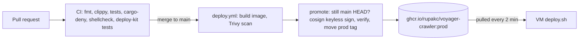

# Operations and Deploy

The crawler runs on **one Google Cloud VM** in project `voyager-prod-ohzkl` (us-east1), next
to the Voyager app VM. Everything runs in Docker Compose. GitHub Actions builds and signs
images but has **no cloud credentials**: the VM pulls and verifies images itself.

> **Status:** the deploy kit (`deploy/`) and the bootstrap script (`infrastructure/`) are
> built and tested with fakes. Nothing is provisioned yet: the image build is skipped until
> the `vcrawl` binary and its Dockerfile land, and go-live (Task 18) comes after the
> end-to-end test.

## The GCP footprint

`infrastructure/bootstrap.sh` creates all of this. It is idempotent (a second run creates
nothing) and has `--dry-run`. Every resource is labelled `app=voyager-crawler`.

| Kind | Name | Notes |
|---|---|---|
| VM | `voyager-crawler` | e2-standard-2 (2 vCPU, 8 GB), Debian 12, Shielded VM, OS Login, auto-restart, deletion protection |
| Data disk | `crawler-data` | 100 GB pd-balanced at `/var/lib/voyager-crawler` (Postgres data, spool, deploy state); daily snapshots kept 7 days |
| IPs | `crawler-internal-ip`, `crawler-external-ip` | static internal (the API, in the TLS cert); static external (the crawl identity in BOT.md) |
| Buckets | `voyager-crawler-raw`, `voyager-crawler-ops` | raw segments and text; backups and batch I/O |
| Service accounts | `crawler-runtime`, `crawler-drill` | the VM; the monthly restore-drill VM |
| Custom roles | `voyagerCrawlerVertex`, `voyagerCrawlerDrill` | Vertex predict and batch jobs; create/delete only `crawler-drill-*` instances |
| Secrets | `crawler-pg-password`, `crawler-api-token-voyager`, `crawler-api-tls-key`, `crawler-api-tls-cert` | the TLS pair is a self-signed P-256 cert for the internal IP, 2 years |
| Firewall | `allow-crawler-api`, `allow-crawler-iap-ssh`, `deny-crawler-ingress` | 8443 only from the app VM's account; SSH only through IAP; everything else denied |
| Monitoring | channel "Voyager crawler alerts" + 9 alert policies | its own email channel, so the app's channel stays quiet |
| Budget | `voyager-crawler` | ₹9,000/month on the label, alerts at 50, 90 and 100 % |

```bash
CRAWLER_ALERT_EMAIL=you@example.org infrastructure/bootstrap.sh --dry-run   # print every command
CRAWLER_ALERT_EMAIL=you@example.org infrastructure/bootstrap.sh             # provision
infrastructure/bootstrap.sh --rotate-tls                                    # new API key and cert
infrastructure/bootstrap.sh --update-host                                   # push a changed deploy/ to the VM
```

## Containers on the VM

| Service | Image | Networks | Memory |
|---|---|---|---|
| `postgres` | `pgvector/pgvector:pg17`, pinned by digest; wal-g mounted read-only | `db`, `pgbackup` | 3 GB |
| `chromium` | `chromedp/headless-shell`, pinned by digest | `render` only | 1.5 GB |
| `scheduler`, `maintenance`, `embedder` | the `vcrawl` image | `db`, `egress` | 256 MB each |
| `fetcher` | the `vcrawl` image, spool on the data disk | `db`, `egress`, `render` | 512 MB |
| `processor` | the `vcrawl` image | `db`, `egress` | 768 MB |
| `api` | the `vcrawl` image, published on the internal IP:8443 | `db`, `egress` | 512 MB |
| `migrate` | one-shot, run by `deploy.sh` | `db`, `egress` | 256 MB |

| Network | Purpose |
|---|---|
| `db` | internal (no route out): Postgres and the roles |
| `render` | internal: Chromium and the fetcher only |
| `egress` | roles that call GCS, Vertex, the metadata server, or (fetcher only, with permits) the web |
| `pgbackup` | Postgres alone: wal-g's route to the ops bucket |

Every role container: read-only root, user 65532, all capabilities dropped,
`no-new-privileges`, `restart: unless-stopped`, logs rotated. Secrets arrive as files in
`/run/secrets`, never as environment values, and are written to tmpfs only.

## Build and release



- On `main`, after CI passes: build `ghcr.io/rupakc/voyager-crawler`, scan with Trivy, sign
  with **cosign keyless** (GitHub OIDC to Sigstore), verify, then move the `prod` tag.
- Signing happens only in the promote job, and only if the commit is still main's HEAD. So
  every signed image passed CI.
- Image labels `io.voyager-crawler.schema` and `io.voyager-crawler.min-schema` record the
  schema range the image works with.
- All GitHub Actions are pinned by commit SHA; images by digest.

## The VM deployer (`deploy.sh`, every 2 minutes)

1. Resolve `:prod` to a digest. Same as running: make sure everything is up, stop.
2. `cosign verify` the digest, pinned to issuer `https://token.actions.githubusercontent.com`
   and identity `deploy.yml@refs/heads/main`. Unsigned or wrongly signed: **held**, never pulled.
3. Pull by digest. Make sure Postgres and Chromium run.
4. Run `vcrawl migrate` with the **new** image. Migrations are expand-only, so the running
   image keeps working. Failure: held, nothing rolled.
5. Roll the roles **one at a time**, waiting for each one's progress-based health check.
   Unhealthy: every rolled role goes back to the previous digest, and the new one is held.
6. Success: the new digest is recorded; the old one becomes the rollback target.

`deploy.sh --rollback` goes back one digest, and refuses if that image's `min-schema` is
above the database schema. Held digests are listed in `$VC_STATE/held`; deleting a line
releases one.

## Self-healing

| Layer | What it does |
|---|---|
| Docker | `restart: unless-stopped` restarts crashed processes |
| Health checks | `vcrawl health` is **progress-based**: for example the fetcher is unhealthy after 10 minutes with no completion while work is due |
| Watchdog (every 2 min) | restarts services that are unhealthy, exited or stuck restarting; after 3 failed restarts in 30 minutes it reboots the VM, at most once per 2 hours; never during a deploy |
| GCE | automatic restart and live migration on host maintenance |

## Backups and drills

| Job | When | What |
|---|---|---|
| WAL archiving | continuous | wal-g streams Postgres WAL to `gs://voyager-crawler-ops/walg/` |
| Base backup | daily 03:15 UTC | backups and WAL expire after 14 days by lifecycle |
| Disk snapshot | daily | kept 7 days |
| Light restore drill | Sundays 05:30 UTC | `wal-g backup-verify` + a schema-only restore into a small container |
| Full restore drill | monthly | a throwaway Spot VM restores the latest backup + WAL, runs equivalence checks, reports `restore_drill_ok`, and deletes itself (about $0.05) |

## Monitoring

Each role exposes `/metrics` and `/healthz` (port 9464). The Ops Agent ships metrics to
Cloud Monitoring as `custom.googleapis.com/crawler/…`. Logs are JSON with a field
allowlist (never page content, tokens or secrets), kept 30 days.

| Alert | Fires when |
|---|---|
| Crawler down | no `heartbeat` metric for 15 minutes (metric absence) |
| No captures | no `captures_committed` for 60 minutes while URLs are due |
| Spool backpressure | fetchers paused (spool > 2 GB or uploads failing 15 min) |
| Disk | data disk above 80 % |
| Backup age | WAL archive or base backup older than 2 hours |
| Restore drill | the last drill failed or is too old |
| LLM spend | monthly spend above 80 % of the cap |
| Parked keys | more than 25 % of active keys parked |
| TLS expiry | API certificate expires within 30 days |

A daily digest (parked keys, top errors, yields, spend) goes to `crawl_digest` and the
crawler email channel. `vcrawl admin status` shows the same on demand.

## Owner's manual steps

1. Choose the crawler alert address; pass it as `CRAWLER_ALERT_EMAIL` (never committed).
2. Raise the project's Gemini spend cap in the console, then set `VC_PROJECT_CAP_USD` to
   match. Until then `VC_LLM_ENABLED=false`.
3. Turn the LLM on: put `VC_LLM_ENABLED=true` and `VC_PROJECT_CAP_USD=…` in
   `/var/lib/voyager-crawler/deploy/host.local.env` and restart the service.
4. Publish the external IP in BOT.md.
5. After 8 weeks, decide on a 1-year commitment for the VM.
6. Review source-scout proposals.
7. Rotate the API certificate yearly, or when the expiry alert fires.

## Go-live plan

> **Status:** not started (Task 18).

1. Review `bootstrap.sh --dry-run`, then run it for real.
2. First deploy with the LLM off.
3. Enable 10 sources, watch for 24 hours (politeness metrics, parks, captures), then enable
   all.
4. Live smoke test on 3 sources (`/v1/stats` must grow), test-fire an alert, run a restore
   drill.
5. Turn the LLM on after the owner raises the project cap.

## Cost (USD per month)

| Item | Cost |
|---|---|
| e2-standard-2 (on-demand for 8 weeks, then a 1-year commitment) | about 31 |
| Disks and snapshots | 13.50 |
| Static IP | 3.65 |
| GCS (raw, text, ops) | 5–8 |
| Gemini (extraction, triage, audit) | 15–25, hard cap 40 |
| Embeddings | about 3 |
| Logging, egress, ops | about 3 |
| **Total** | **about $75–90** steady state, at most about $105 |

See also: [Configuration](Configuration), [Security](Security).
