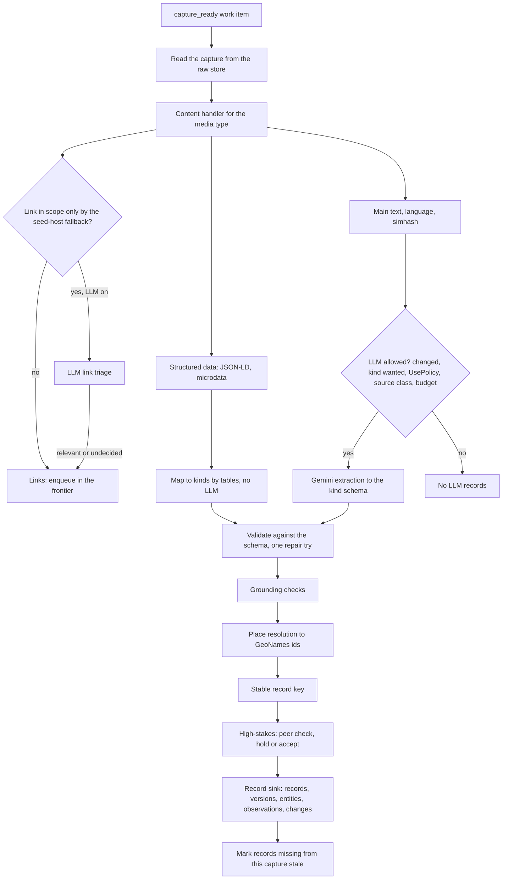

# Processing and Extraction

Processing turns a committed capture into clean, versioned **records**. It runs in the
`processor` role, which takes `capture_ready` items from the work queue.

- Delivery is **at-least-once**: an item can be processed twice (for example after a crash).
- Every write is **idempotent** on (capture id, extraction run id, record key), so a second
  run changes nothing.
- Work payloads hold ids only, never page content.

> **Status:** every step below is built, wired into the `processor` role and covered by the
> end-to-end tests. The LLM steps (extraction, repair, link triage, place disambiguation)
> run only when `llm.enabled` is true; it is off by default (see
> [Gemini and Budgets](Gemini-and-Budgets)).

## Pipeline

## 1. Content handlers

`vc-parse` has one handler per media type. Handlers never fetch anything.

| Handler | Media types | Output |
|---|---|---|
| HTML | `html` | title, main text (via `dom_smoothie`), language, links with anchor text, JSON-LD and microdata, meta robots and TDMRep signals, simhash, `needs_render` |
| Feed | `rss`, `atom` | title, language, one `feed_item` link per entry |
| Sitemap | `sitemap`, `sitemap_text` | page links (`<urlset>`) or sitemap links (`<sitemapindex>`) with `lastmod`; gzip accepted |
| JSON | `json` | JSON-LD flattened, else the whole document as one value |
| CSV | `csv` | rows as objects keyed by the header (up to 50,000 rows) |

**Reading the capture.** A `revisit` (a 304, or an identical body) points to an earlier
record. The processor follows that chain (at most 64 hops, cycle-safe) to the stored body.
If a purge rewrote the segment while it was reading, it reloads the capture row and tries
once more; if the body is still missing, the item is retried later instead of dropped.

**Finding the capture.** Capture times are stamped in whole microseconds (`vc_core::store::capture_time`), so the WARC header, CDXJ, the `capture_ready` payload and `captures.captured_at` hold the same instant. For captures stored before that fix, the lookup by `(capture_id, captured_at)` allows 1 microsecond of difference, then uses the stored value. A capture that still cannot be found (`missing`) or has no known source (`no_source`) is acknowledged as skipped, logged at WARN and counted in `crawler_processor_skipped_total{reason}`. It is never dropped silently.

Safety limits: XML with a DTD is refused (no entity expansion); the DOM is pruned to depth
256 and 200,000 nodes before anything walks it; main text is capped at 1 MiB, links at
5,000, sitemap entries at 50,000; CPU time per capture is capped at 5 s. **Simhash** (a
64-bit fingerprint where similar texts get similar numbers) helps spot near-duplicates.

**Link triage.** Most links are followed or not by the source's `include`/`exclude`
patterns. A link that is in scope only because it is on a seed host (the source has no
`include` patterns) is "uncertain". When the LLM is on, the processor sends a capture's
uncertain links to the triage loop in one batch (see [Agentic Loops](Agentic-Loops)).
A `relevant: false` answer keeps the link out of the frontier. If the call is refused,
fails or cannot be parsed, the link is followed as before. Verdicts are cached by URL
pattern, so similar links make no new call. Sitemap and feed entries are never triaged.

## 2. Structured data first

schema.org objects (Event, Place, TouristAttraction, LodgingBusiness, Article, FAQPage and
similar) are mapped to the kind schemas by fixed tables, with **no LLM call**. Examples:
`name` or `headline` to `name`; `startDate` to `start_date` and `start_time`; `geo` to
`lat`/`lng`; `telephone` to `phone`; the first `offers` to `price`; `openingHours` to
`opening_hours`. The record is then fitted to the schema (unknown fields dropped, long
strings cut, bad enum values removed) and dropped if it still does not validate.

API and dump adapters produce their own structured rows the same way.

## 3. LLM extraction (only when everything allows it)

Gemini is called only if **all** of these hold:

1. the payload changed since the last capture;
2. the source asks for this kind in `llm_kinds`;
3. the capture's UsePolicy allows LLM use (no TDM reservation, no AI-bot block);
4. the kind allows this source class (high-stakes kinds: official only);
5. the budget ledger reserves the estimated cost (see [Gemini and Budgets](Gemini-and-Budgets)).

Input: trimmed main text, at most 1,200 tokens per chunk and 3 chunks. Output: JSON of the
kind's schema (`responseSchema`), at most 400 tokens, temperature 0.1, no tools. At most 20
records per call are accepted.

**Prompt-injection containment.** Page text is placed only in the input, inside delimiters
the page cannot forge, under a system prompt that says it is untrusted data. Marker-like
strings in the page are defanged. The delimiter nonce is a hash of the page text (blake3),
so a recapture of an unchanged page sends the identical request and hits the LLM cache. The model has
no tools and can only answer with schema JSON. Logs carry counts and ids, never page text
or model output.

## 4. Validation and repair

Every record is validated against the kind's JSON Schema (draft 2020-12). On failure, the
pipeline tries **one** repair call; if it still fails, the record is dropped.

## 5. Grounding checks

These catch planted data such as fake emergency numbers or phishing links.

| Check | Rule |
|---|---|
| Verbatim fields | Fields marked `verbatim` in `kinds.toml` (phones, URLs, prices, dates, emergency numbers, evidence quotes) must appear in the source text after normalisation, or they are dropped. |
| URLs | Every URL must be on the source's own registrable domain or be one of the page's links. For high-stakes kinds, only the own domain counts. Non-HTTP schemes and URLs with credentials are always dropped. |
| Arrays | Dropping a field inside an array element drops the whole element (a phone entry without its number could mislead). |
| Re-validate | After drops, the record is validated again and removed if it no longer fits. |
| Cross-source | If independent sources disagree on a high-stakes field, the record gets `conflict = true`, and the API shows it (see "Peer agreement" below). |

The word "free" counts as grounding for a zero price.

## 6. Source-class gate

| Kind | Allowed source classes |
|---|---|
| `visa_rule`, `advisory` | `official` only, enforced in code whatever `kinds.toml` says |
| `emergency_numbers` | `official`, or `reference` when **two independent reference sources agree** |
| Others | as listed per kind in `kinds.toml` |

A high-stakes kind from a non-official source is refused **before** any model call. The
kind loader also refuses `kinds.toml` files that would weaken these rules; `kinds.toml` can
only make them stricter.

### Peer agreement

For high-stakes records, other records of the same kind (**peers**) are looked up in the
index after extraction.

| Rule | Meaning |
|---|---|
| Independent | A peer counts only if it comes from another **publisher** (registrable domain via the PSL). Several sources of one publisher count once. |
| Same place | Peers are filtered by place **before** the 500-row limit: a shared GeoNames id, or for country-level records without place ids, the same country. A record with no location never agrees or conflicts. A city-level record never matches a country-level one. |
| Agrees | The peer covers and equals **every** non-empty fact group of the record (numbers, phones, URLs, …). Agreeing on the numbers alone does not vouch for a planted embassy phone. |
| Conflicts | A fact group both carry differs. A group the peer lacks is neither. |

Accepted records with a conflict are flagged. `emergency_numbers` from a `reference` source
is **held** until a second independent source agrees, then accepted with its own
provenance. Held records are kept in the `held_records` table (migration 1901), shared by
all processors and kept across restarts: at most 10,000 (oldest dropped first), each for
7 days. A newer capture replaces a held record; an older one never does.

## 7. Place resolution

`FilePlaceResolver` matches place names against an exported GeoNames subset in
`crates/vc-extract/data/` (`places.tsv.gz`, `countries.tsv.gz`, `admin1.tsv.gz`), with
country hints. Matches scoring below 0.5 are left unresolved (`place_ids = []`). When the top
two candidates are within 0.15 of each other, the LLM may choose between them, only under
budget, and only among those candidates. Contains data from GeoNames (geonames.org), CC BY 4.0.

## 8. Record keys

A page can yield many records (for example 30 events). Each gets a stable `record_key`:

1. the JSON-LD `@id` or a same-page URL anchor, else
2. a hash of (kind, normalised name, date or geo), else
3. a per-page singleton key for a nameless record.

So the same event found again maps to the same record, and a new **version** is written
only when its data changes.

**Stale records.** When a newer capture of a page no longer contains a record that an
earlier capture produced, the record is marked `stale` (migration 1902). It is not deleted
and is still served; `stale_since` and the capture that missed it are recorded, and a
change-feed row is written. A later capture that has it again re-activates it. Absence
counts only where this capture could have produced the record: an LLM record is never
staled because the LLM was off, over budget, blocked by UsePolicy or failed. An older
capture never stales or re-activates a record that a newer capture already judged.

## 9. Quality, runs and canaries

- Records below quality 0.3 are dropped.
- Each extraction setup (kind, schema version, prompt hash, model) is an **extraction run**.
  A changed prompt or schema first runs as a **canary** on 200 records and is compared with
  the previous run before it rolls out under the budget.

## 10. Writing the result

`vc-index` writes one transaction per capture: records, versions, observations, entities
and change-feed rows. See [Data Model](Data-Model).

Ordering rules keep the index correct when work arrives late or in parallel:

- A tombstone (removal) and an upsert of the same records cannot interleave: they share a
  database lock, so an upsert either lands before the tombstone (and is removed by it) or
  sees it and stays out.
- An older capture never re-activates a record a newer capture staled, and never adds a
  record to a page and kind that a newer capture already judged.
- No embedding is written for a record after it is tombstoned.
- Observation tombstones carry their kind (migration 1502), so kind-filtered change-feed
  clients see them.

Code: [vc-parse](Crate-vc-parse), [vc-kinds](Crate-vc-kinds), [vc-extract](Crate-vc-extract),
[vc-index](Crate-vc-index).
