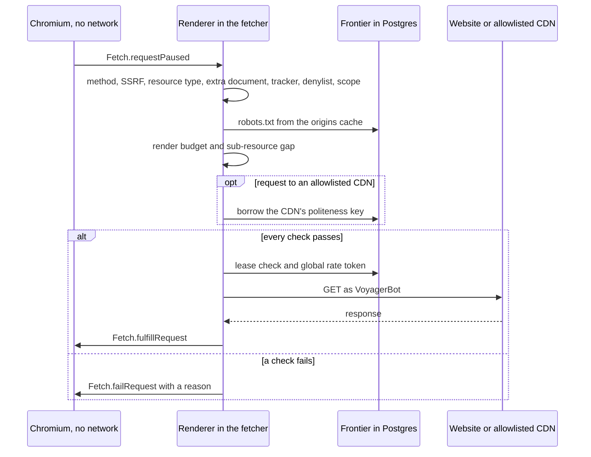

# Rendering with Chromium

A few pages show their content only after JavaScript runs. For those, the crawler uses a
headless Chromium. The browser is **isolated**: it has no network of its own, and every
request it wants to make is answered by the crawler under the same rules as any other
request.

## When a page is rendered

Each source sets `render: never | auto | always`.

- `never`: plain HTTP only (most sources).
- `always`: every page of the source is rendered.
- `auto`: the HTML parser flags a page as `needs_render` when it has less than 200
  characters of main text or looks like an empty single-page-app shell. The design is to
  queue that URL again in `render` mode, under a new claim; this step is not wired yet.

Rendering is off by default (`render.enabled = false`), and production does not turn it
on yet ([Configuration](Configuration)).

## Isolation

| Measure | How |
|---|---|
| No network | Chromium runs on a Docker network (`render`) marked `internal`, with no route out. Its only peer is the fetcher. |
| No data access | It cannot reach Postgres, GCS or the metadata server. |
| Sandbox on | Chrome's own sandbox stays on (no `--no-sandbox`), with a seccomp profile (`deploy/chromium/seccomp.json`). |
| Least privilege | Non-root user, read-only root filesystem, all Linux capabilities dropped, `no-new-privileges`. |
| Memory | 1.5 GB limit. |
| Pinned image | `chromedp/headless-shell`, pinned by digest. |
| Fresh state | Each render uses a fresh browser context: no shared cookies, storage or HTTP cache. The CDP session is restarted after 200 renders. |
| No side traffic | `deploy/chromium/run.sh` turns off DNS prefetch, network prediction, prerendering, pings and background services, so Chromium does not even try to send anything outside interception. |
| Nothing to reach | The fetcher's metrics endpoint is on a separate `metrics` network, so Chromium's network has no listener but the CDP connection. |

## CDP Fetch interception

**CDP** (Chrome DevTools Protocol) lets a program drive Chrome. The renderer turns on
`Fetch.enable` for every URL pattern. Chrome then **pauses** every request (document, script,
stylesheet, XHR, fetch) and asks the renderer what to do.

For each paused request the renderer:

1. **checks policy:** GET over http(s) only; SSRF; blocked resource types (images, media,
   fonts and anything else that does not build the DOM); **extra documents** (see below);
   known trackers; the denylist; the permit scope (the page's own key, or a host in
   `policy/subresource_allowlist.yaml` **with that resource type** listed for it); robots.txt
   from the frontier's cache. A missing or stale robots entry fails the request and queues
   a refresh: the renderer never fetches robots.txt itself;
2. **fetches through the `PermitClient`**: lease check + global rate token per request, the
   one `VoyagerBot` User-Agent, one request at a time. Sub-requests wait the
   **sub-resource gap** (250 ms) instead of the page delay; the gap is applied inside the
   permit client's `admit` and never exceeds the key's delay. The next page of the claim
   still waits the full delay. A third-party request first borrows that host's key (below);
3. **answers** with `Fetch.fulfillRequest`, or `Fetch.failRequest` with a reason (`ssrf`,
   `denylisted`, `robots_disallowed`, `robots_unavailable`, `out_of_scope`, `resource_type`,
   `tracker`, `budget`, `method`, `fetch_failed`).

### One document per render

Only the page's own document loads as a document. Iframes (same key or third party) and
navigations by script or meta refresh, even back to the page itself, are refused as
`resource_type` and never fetched. Worker and service-worker scripts are refused too.

Every real request becomes a normal exchange, stored as WARC `request`/`response` records
next to the final DOM (`resource` record), in the same spool. Refused requests are listed
in the render outcome.

## Allowlisted sub-resource hosts

`policy/subresource_allowlist.yaml` lists a few public CDNs (for example
`cdnjs.cloudflare.com`, `cdn.jsdelivr.net`, `unpkg.com`) with the resource types allowed
from each (lower-case CDP types such as `script` or `stylesheet`). A request of a type not
listed for that host is out of scope. Denylisted hosts are refused even if listed. If the
policy files cannot be read, every third-party request is refused. These hosts are seeded
as politeness keys so their robots.txt stays fresh. Each sub-request to them still passes
the full gate and counts against the global rate.

Third-party hosts are paced twice:

| Layer | Scope | Rule |
|---|---|---|
| In-process lock | every tab and renderer in the fetcher process | one request at a time per host, at least the sub-resource gap apart; a wait past the render deadline refuses the request as `budget` |
| Key borrow | every process, through Postgres | the request **borrows** the CDN's own politeness key: granted only if its `next_allowed_at` has passed, it is not parked and no claim is in flight. The key's `next_allowed_at` then moves on by its delay, and again when the request ends. A refused borrow fails that sub-request at once; nothing waits. |

The borrow lives in `vcrawl`'s `wiring::fetch::third_party_gate`, which wraps the renderer's
permit client. Cache hits skip both layers.

## Budgets

| Limit | Default |
|---|---|
| Time per render | 90 s (also bounded by the claim deadline) |
| Sub-requests per render | 60 |
| Decoded bytes per render | 20 MB |
| "Network idle" | no paused request outstanding for 1 s |
| Sub-resource gap (same host) | 250 ms, never more than the key's delay |
| Concurrent tabs | at most 2 |

After network idle, the renderer scrolls to the bottom a few times (stopping when the page
stops growing) and clicks allowlisted "expand" selectors once, then saves the DOM.

## Sub-resource cache

Scripts and stylesheets are cached in memory, content-addressed by BLAKE3, for 24 hours,
shared across renders (max 64 MiB). Most of a site's JS and CSS is therefore fetched about
once a day. The cache is looked up **after** every policy check, so it never bypasses
robots, scope or the denylist. Only 200 responses are cached.

## Blocks and errors

- A challenge, 401 or 403 on the page's **own key** aborts the render and parks the key.
  Nothing is retried in another way.
- A 429 or 503 on the page's own key, on the document or on any sub-request, also ends the
  render. The key backs off like any rate-limited key, honouring `Retry-After`
  ([Politeness and Robots](Politeness-and-Robots)).
- A 403, 429 or 503 from an allowlisted third-party CDN only fails that sub-request; it does
  not park the page's key.
- A lost lease aborts the render before any further request.
- A document that redirects to another key ends the render; the caller enqueues the target.

The rendered page's own status follows the same ladder as a plain fetch:

| Page status | Result |
|---|---|
| 2xx, 304 | DOM stored as fetched |
| 404, 410 | URL gone |
| 429, 503 | key rate-limited (with `Retry-After`), render stops |
| other 5xx | counts toward the key's run of server errors |
| other non-2xx | permanent failure for that URL |

## Known limitation: child targets

Workers and out-of-process iframes run as Chromium **child targets**. With chromiumoxide
0.9.1 the renderer cannot enable `Fetch` interception on them before they start. The risk is
contained: other documents and worker scripts are refused, non-http(s) URLs are refused,
and Chromium sits on the internal `render` network with no route out and no other listener.
See [Security](Security).

> **Status:** the fetcher renders URLs queued in `render` mode (the seeds of `always`
> sources, and links and redirects found from them), with the third-party borrow above.
> Tested with a mock CDP and against the pinned headless-shell image. Not done yet:
> re-queueing an `auto` page that the parser flags `needs_render`. Rendering is still off in
> production (`render.enabled = false`).

Code: [vc-render](Crate-vc-render).
