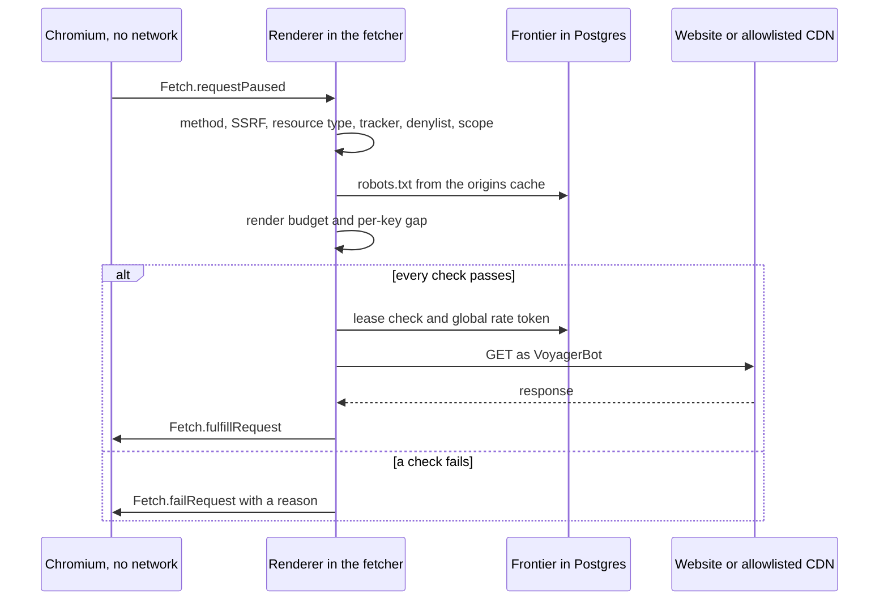

# Rendering with Chromium

A few pages show their content only after JavaScript runs. For those, the crawler uses a
headless Chromium. The browser is **isolated**: it has no network of its own, and every
request it wants to make is answered by the crawler under the same rules as any other
request.

## When a page is rendered

Each source sets `render: never | auto | always`.

- `never`: plain HTTP only (most sources).
- `always`: every page of the source is rendered.
- `auto`: the HTML parser flags a page as `needs_render` when it has less than 200
  characters of main text or looks like an empty single-page-app shell. That URL is then
  queued again in `render` mode, under a new claim.

Rendering is off by default (`render.enabled = false`).

## Isolation

| Measure | How |
|---|---|
| No network | Chromium runs on a Docker network (`render`) marked `internal`, with no route out. Its only peer is the fetcher. |
| No data access | It cannot reach Postgres, GCS or the metadata server. |
| Sandbox on | Chrome's own sandbox stays on (no `--no-sandbox`), with a seccomp profile (`deploy/chromium/seccomp.json`). |
| Least privilege | Non-root user, read-only root filesystem, all Linux capabilities dropped, `no-new-privileges`. |
| Memory | 1.5 GB limit. |
| Pinned image | `chromedp/headless-shell`, pinned by digest. |
| Fresh state | Each render uses a fresh browser context: no shared cookies, storage or HTTP cache. The CDP session is restarted after 200 renders. |

## CDP Fetch interception

**CDP** (Chrome DevTools Protocol) lets a program drive Chrome. The renderer turns on
`Fetch.enable` for every URL pattern. Chrome then **pauses** every request (document, script,
stylesheet, XHR, fetch) and asks the renderer what to do.

For each paused request the renderer:

1. **checks policy:** GET over http(s) only; SSRF; blocked resource types (images, media,
   fonts and anything else that does not build the DOM); known trackers; the denylist; the
   permit scope (the page's own key, or a host in `policy/subresource_allowlist.yaml` with
   allowed types); robots.txt from the frontier's cache. A missing or stale robots entry
   fails the request and queues a refresh: the renderer never fetches robots.txt itself;
2. **fetches through the `PermitClient`**: lease check + global rate token per request, the
   one `VoyagerBot` User-Agent, one request at a time, same-key sub-requests at least 250 ms
   apart;
3. **answers** with `Fetch.fulfillRequest`, or `Fetch.failRequest` with a reason (`ssrf`,
   `denylisted`, `robots_disallowed`, `robots_unavailable`, `out_of_scope`, `resource_type`,
   `tracker`, `budget`, `method`, `fetch_failed`).

Every real request becomes a normal exchange, stored as WARC `request`/`response` records
next to the final DOM (`resource` record), in the same spool. Refused requests are listed
in the render outcome.

## Allowlisted sub-resource hosts

`policy/subresource_allowlist.yaml` lists a few public CDNs (for example
`cdnjs.cloudflare.com`, `cdn.jsdelivr.net`, `unpkg.com`) with the resource types allowed
from each. These hosts are seeded as politeness keys so their robots.txt stays fresh. Each
sub-request to them still passes the full gate and counts against the global rate.

## Budgets

| Limit | Default |
|---|---|
| Time per render | 90 s (also bounded by the claim deadline) |
| Sub-requests per render | 60 |
| Decoded bytes per render | 20 MB |
| "Network idle" | no paused request outstanding for 1 s |
| Same-key sub-request gap | 250 ms |
| Concurrent tabs | at most 2 |

After network idle, the renderer scrolls to the bottom a few times (stopping when the page
stops growing) and clicks allowlisted "expand" selectors once, then saves the DOM.

## Sub-resource cache

Scripts and stylesheets are cached in memory, content-addressed by BLAKE3, for 24 hours,
shared across renders (max 64 MiB). Most of a site's JS and CSS is therefore fetched about
once a day. The cache is looked up **after** every policy check, so it never bypasses
robots, scope or the denylist. Only 200 responses are cached.

## Blocks and errors

- A challenge, 401 or 403 on the page's **own key** aborts the render and parks the key.
  Nothing is retried in another way.
- A 403 from an allowlisted third-party CDN only fails that sub-request; it does not park
  the page's key.
- A lost lease aborts the render before any further request.
- A document that redirects to another key ends the render; the caller enqueues the target.

> **Status:** the renderer, its policy logic and the compose wiring are built and tested
> (with a mock CDP and against a real headless-shell image). Deciding when to render inside
> the fetcher loop is part of the `vcrawl` wiring in progress.

Code: [vc-render](Crate-vc-render).
